<table>
<tr>
<td width="65%" valign="top">

### Junior full-stack developer

I build tools people actually use, from backend to interface.

- Led architecture and built the Go backend for **Foxy** (Hackathon Nicaragua 2026).
- Sole developer of a management system for academies and sports centers.
- Built a live research platform for a university study.
- Currently learning **Rust** and **Flutter**.

**Open to junior roles and internships.**

</td>
<td width="35%" align="center">

</td>
</tr>
</table>

<table>
<tr>
<td width="33%" valign="top">

**[Foxy](https://github.com/racconrad/foxy-app)** 
Hackathon · Project lead + backend  
AI learning platform that adapts explanations, study plans, and quizzes to each student's material.  

</td>
<td width="33%" valign="top">

**[Sys-Sentinel](https://github.com/racconrad/astro-sentinel)** 
University · Sole developer  
Management system for dance academies and sports centers: memberships, classes, payments, and website content.  

</td>
<td width="33%" valign="top">

**[Attention & Habits](https://github.com/racconrad/dreams-root)** 
University research · <a href="https://dreams-root.vercel.app">Live ↗</a>  
Study platform measuring how digital habits relate to sustained attention: validated questionnaires and a CPT test.  

</td>
</tr>
</table>

| | |
| :-- | :-- |
| **Strong** |  |
| **Project experience** |  |
| **Learning** |  |

