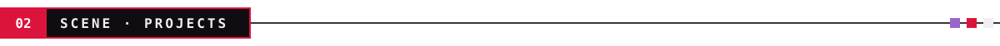
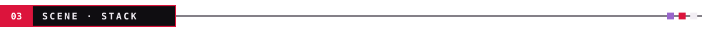
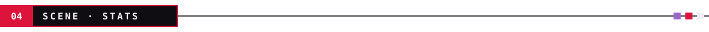
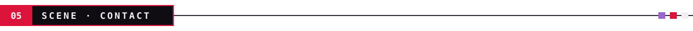
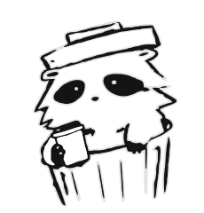

<table>
<tr>
<td width="62%" valign="top">

### `> whoami`

Junior developer. I enjoy designing and building **useful tools**, with care for **how they feel to use**.

- 🎬 Every project is a little scene: a problem, a cast of tools, and an ending that works.
- 🧭 Led architecture and the Go backend for **Foxy** at Hackathon Nicaragua 2026.
- 🐧 I live on Linux: login themes, desktop widgets, and too many dotfiles.
- 🌱 Learning **Rust**, algorithms, software engineering, and **Flutter**.
- 🐾 And yes, my apps tend to have little cats.

</td>
<td width="38%" align="center">

</td>
</tr>
</table>

<table>
<tr>
<td width="33%" valign="top">

**🐱 [KWallet](https://github.com/racconrad/kwallet)** 
Money, habits, and little cats.  
Local-first finances, habits, and notes with a pixel companion that levels up with you.  

</td>
<td width="33%" valign="top">

**🦊 [Foxy](https://github.com/racconrad/foxy-app)** 
Learning with your own context.  
AI study platform that adapts explanations, plans, and quizzes to the student's material.  

</td>
<td width="33%" valign="top">

**🛡️ [Sys-Sentinel](https://github.com/racconrad/astro-sentinel)** 
Less busywork. More academy.  
Management for dance academies and sports centers: memberships, classes, payments, and site content.  

</td>
</tr>
<tr>
<td valign="top">

**🧩 [tinyWidgets](https://github.com/racconrad/tinyWidgets)** 
Tiny widgets, their own corner.  
Linux desktop widget manager: cats, clocks, music, tasks, and GitHub activity.  

</td>
<td valign="top">

**👁️ [Attention & Habits](https://github.com/racconrad/dreams-root)** 
Research in a single sitting. · <a href="https://dreams-root.vercel.app">live ↗</a>  
University study platform on digital habits and students' sustained attention.  

</td>
<td valign="top">

**🖥️ [GlaD0sTy](https://github.com/racconrad/sddm-GlaD0sTy)** 
Log in to Aperture Science.  
SDDM login theme: a CRT terminal with scanlines and an AI that comments on your typing.  

</td>
</tr>
</table>

Also backstage: <a href="https://github.com/racconrad/Urban">Urban</a> (C# · .NET MAUI) · <a href="https://github.com/racconrad/dunobot">Dunobot</a> (Go) · <a href="https://racconrad.github.io/Limbo-Keys-Javascript/">Limbo Keys</a> (JS)

| Level | Tools |
| :-- | :-- |
| ★★★ **Comfortable** |  |
| ★★☆ **Project experience** |  |
| ★☆☆ **Exploring** |  |

  

<table>
<tr>
<td width="62%" valign="top">

Looking for a **junior developer role or internship** on a team where I can contribute and keep learning.

`> shutdown raccon-files` · thanks for watching ✦

</td>
<td width="38%" align="center">

</td>
</tr>
</table>
